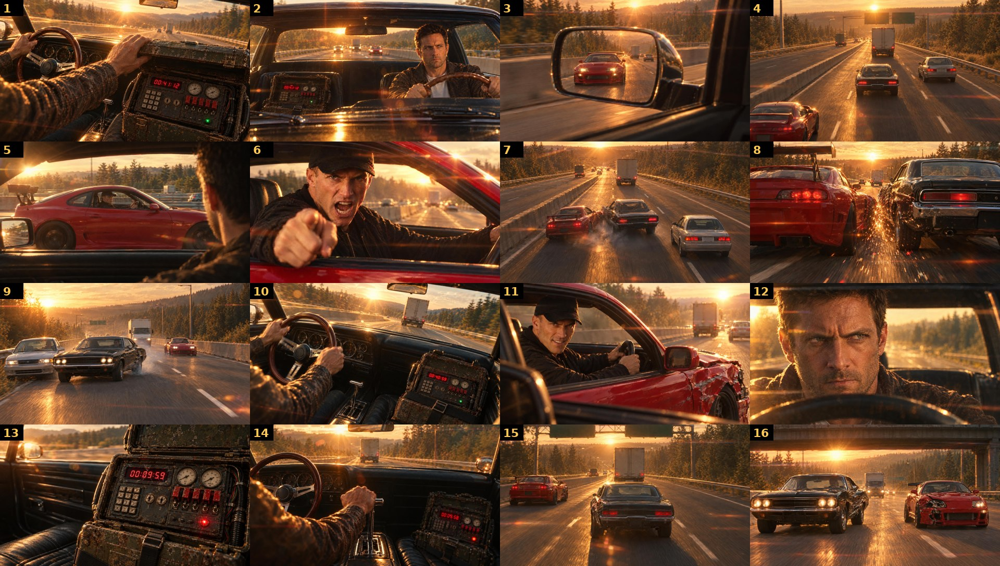

# 01 · GOLDEN HOUR, scene 38 "The Squeeze"

A 13-second, 16-shot car-chase scene made with an LLM agent (Claude Code) as director and producer:
Blender clay previs → GPT Image 2.5 asset sheets and keyframes → image-to-video on fal (Kling 3.0 Turbo Pro and
H3 Max Turbo) → Lyria 3.5 score, synced SFX, ElevenLabs voice → scripted ffmpeg edit.

**Final cut:** [`final/golden_hour_s38_v3_mixed.mp4`](final/golden_hour_s38_v3_mixed.mp4) (1920×1080, 24 fps, 312 frames, −13.9 LUFS)
**Model comparison:** [`final/golden_hour_s38_v3_compare_2x2.mp4`](final/golden_hour_s38_v3_compare_2x2.mp4) (Kling | H3 | Mixed)
**Retrospective:** [`RETRO.md`](RETRO.md) · **Design board:** [`board/index.html`](board/index.html)

## Story

1997. A stolen Soviet suitcase nuke is armed, and its clock reads 41 minutes. Ex-rally driver Eli runs it across
the valley; the buyers' wheelman Kaz catches him on the interstate. Kaz shouts "STOP… OR DIE!", rams Eli,
nearly pushes him into a civilian sedan, and the impact makes the clock jump to 00:09:59. Eli answers with the
shifter and squeezes past the truck.

## Pipeline

| # | Stage | Tool | Folder |
|---|---|---|---|
| 1 | Story, bible, shot list | Claude Code | [`docs/`](docs) |
| 2 | Layout truth: clay previs, collision stills | Blender 4.0 (Python) | [`previs/`](previs) |
| 3 | Asset sheets: cast, cars, device, 90s props, plates, grade key, damage | GPT Image 2.5 (fal) | [`assets/`](assets) |
| 4 | Keyframes: clay frame as image 1 + sheets, 3 QA rounds | GPT Image 2.5 edit | [`keyframes/`](keyframes) |
| 5 | Design board: shots, prompts, refs, styling, sound | HTML generator | [`board/`](board) |
| 6 | Image-to-video, both models for all 16 shots | Kling 3.0 Turbo Pro, H3 Max Turbo (fal) | [`video/`](video) |
| 7 | Music, SFX, voice | Lyria 3.5, Sonilo v1.1, ElevenLabs SFX v2 + Eleven v4 | [`sound/`](sound) |
| 8 | Conform edit, mix, comparison cuts | ffmpeg scripts | [`edit/`](edit), [`final/`](final) |
| 9 | Quality review: metrics, 100 % crops, A/B | numpy | [`review/`](review) |

## Result of the model comparison

| | Kling 3.0 Turbo Pro | H3 Max Turbo |
|---|---|---|
| Image quality | **8.6** | 7.3 |
| Realism | **8.4** | 7.4 |
| Stability in a take | 8.0 (hidden cuts in 3/16) | 7.4 (no cuts, drift) |
| First frame = keyframe | **9.1** | 7.0 |
| Performs the asked action | 7.6 | **8.9** |
| Weighted total | **≈ 8.4** | ≈ 7.6 |
| Price | $0.14/s | **$0.015/s** |

Mixed cut: H3 Max Turbo for shots 1, 5, 10, 13, 14 (inserts and action-heavy moves), Kling for faces and car action.

## Notes

- Takes in `video/` are 720p copies; final cuts in `final/` are full 1080p.
- `assets/fal_urls.txt` and `video/*/urls.txt` list the original fal CDN outputs (they may expire).
- Generated media was made with commercial models on fal; check each model's terms before commercial reuse.
